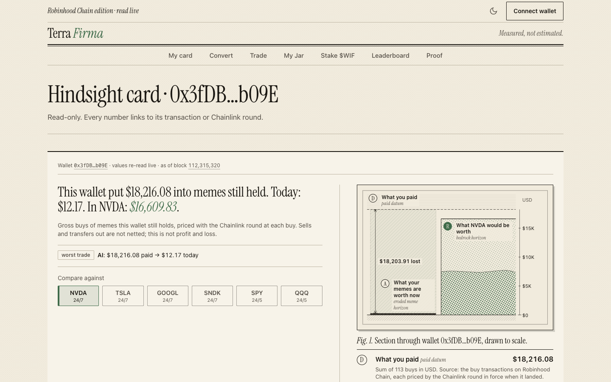
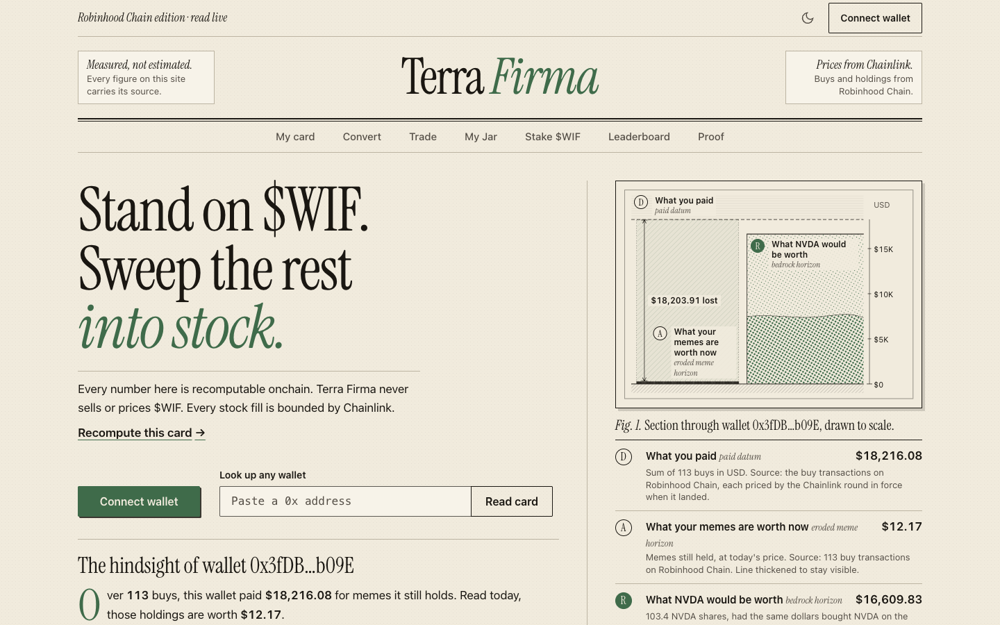
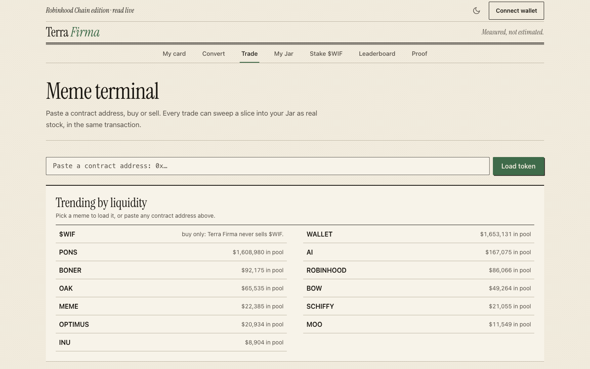
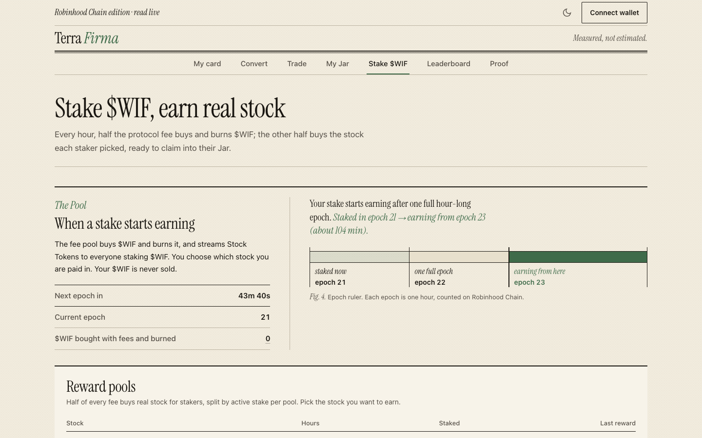
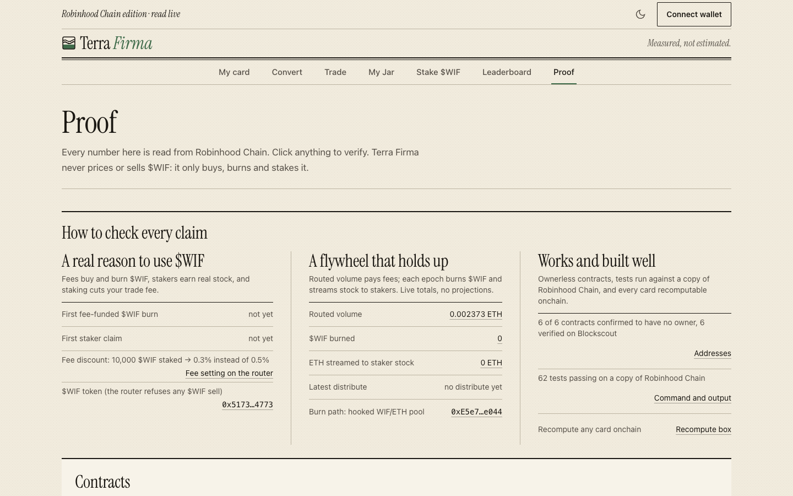
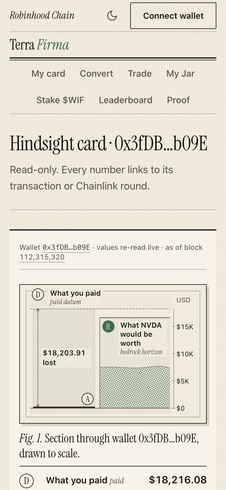

<p align="center">
  
</p>

<h1 align="center">Terra Firma</h1>

<p align="center"><b>Your memes, in real stock. Stand on $WIF, sweep the rest into Stock Tokens.</b></p>

<p align="center">
  <a href="https://terra-firma-henna.vercel.app">Live app</a> ·
  <a href="https://terra-firma-henna.vercel.app/card/0x3fDBeB0FC14cca8fDd238Dd21725F0b8585Ab09E">A real Hindsight card</a> ·
  <a href="https://terra-firma-henna.vercel.app/proof">Proof page</a> ·
  <a href="#proof-robinhood-chain-mainnet-4663">Contracts</a>
</p>

<p align="center">
  
  
  
  
  
</p>

> Measured, not estimated.

Built for the World is Flat hackathon on Robinhood Chain.

---

## The problem, measured on one real wallet

Robinhood Chain carries more than 200 real Stock Tokens with Chainlink feeds and deep Uniswap pools. Most onchain
activity still goes into memecoins, and most memecoins go to zero.

Here is one real wallet, priced by Terra Firma straight from chain logs and Chainlink rounds
([open the live card](https://terra-firma-henna.vercel.app/card/0x3fDBeB0FC14cca8fDd238Dd21725F0b8585Ab09E)):

| Wallet `0x3fDB...b09E` (113 buys of AI, as of block 112,315,187) | USD |
|---|---|
| Paid into memes it still holds (each buy priced with the Chainlink ETH/USD round in force at that block) | **$18,216.08** |
| What those memes are worth today | **$12.17** |
| What the same dollars would be worth in NVDA (historical NVDA/USD round at each buy) | **$16,609.83** |

Every number above links to its transaction or Chainlink round on the card, and the pricing can be recomputed onchain
by anyone through `HindsightLens.recompute`. No number on the site is typed by hand.



## What Terra Firma does

1. **Hindsight card.** Paste or connect any wallet. Terra Firma indexes its meme buys from onchain logs, prices what was
   paid with the Chainlink round in force at each buy, and prices the counterfactual from the historical round of a
   stock you pick (NVDA, TSLA, GOOGL, SNDK, SPY, QQQ). Read-only cards work for any wallet, no connection needed.
2. **Convert.** Pick the non-$WIF memes you hold and sell them into a real Stock Token in one transaction (after a
   one-time approval per meme). The stock lands in your **Jar**, an ownerless contract ledger you can withdraw from at
   any time.
3. **Meme terminal with a sweep.** Paste a token address, buy or sell through the Uniswap Universal Router across
   v2/v3/v4 pools (including hooked launchpad pools). A slice of every trade you choose (default 2%, 0 to 10%) is swept
   into real stock in your Jar, in the same transaction.
4. **Stake $WIF, earn real stock.** Every routed trade and convert pays a 0.5% fee into the FeePool. Each hourly epoch
   half the pool buys $WIF and burns it, and half buys real stock that streams to $WIF stakers, each staker choosing
   their reward stock.

## How $WIF is used onchain

Terra Firma only ever **buys, burns and stakes** $WIF. It never sells it and never reads a $WIF price in value logic.

| Use | Mechanism | Where it is enforced |
|---|---|---|
| Buy and burn | Half of every epoch's fees buys $WIF on the WIF/ETH pool and calls `burn` | `contracts/src/FeePool.sol:90` (`distribute`), burn at `:114`; capped at `MAX_WIF_BUY_ETH` (`:27`) |
| Claim on protocol revenue | Stakers receive real Stock Tokens bought with the other half of the fees | `contracts/src/WifStaking.sol` (`notifyReward`, `claim`) |
| Fee discount | 10,000 $WIF staked and active cuts the trade fee from 0.5% to 0.3% | `contracts/src/TerraRouter.sol:32` (`STAKER_FEE_BPS`), `feeBps()` |
| Card mint | Minting a Hindsight card onchain burns 1 $WIF | `contracts/src/HindsightLens.sol` (`mintCard`, `CARD_BURN = 1e18`) |
| Never sold | Any sell or convert route whose input is $WIF reverts | `contracts/src/TerraRouter.sol:194` (`WifNotSellable`) |

Delete $WIF and the staker stock stream, the burn and the fee discount all disappear. That is the reason to hold it.

## Screenshots

| Landing | Meme terminal |
|---|---|
|  |  |
| **Stake $WIF** | **Proof** |
|  |  |

Every route was also captured at 375px with mobile emulation and has no horizontal overflow
(`docs/screenshots/*-mobile.png`).

<p align="center"></p>

## Proof (Robinhood Chain mainnet 4663)

Deployed at block **111,602,102**. All seven contracts are verified with a Sourcify `exact_match` and show as verified on
[Blockscout](https://robinhoodchain.blockscout.com). Source of truth: `contracts/deployments/4663.json`.

| Contract | Address | Role |
|---|---|---|
| TerraRouter | [`0xBa4d301D9fD6f5e96c47961EE582851AF4db56Fa`](https://robinhoodchain.blockscout.com/address/0xBa4d301D9fD6f5e96c47961EE582851AF4db56Fa) | Meme buy/sell/convert over the Universal Router, same-tx sweep, fee |
| Jar | [`0xa921DCaF524c4A50f46F26543B0EA3DBD2a4d5bF`](https://robinhoodchain.blockscout.com/address/0xa921DCaF524c4A50f46F26543B0EA3DBD2a4d5bF) | Ownerless per-user Stock Token ledger |
| FeePool | [`0xb1FDE1C822a3fA7542B7A87D730a1969B2bFf5EB`](https://robinhoodchain.blockscout.com/address/0xb1FDE1C822a3fA7542B7A87D730a1969B2bFf5EB) | Hourly $WIF buy-and-burn + stock buy for stakers |
| WifStaking | [`0x065783d9C37c10E1067B5042108E9EEa24429571`](https://robinhoodchain.blockscout.com/address/0x065783d9C37c10E1067B5042108E9EEa24429571) | Stake $WIF, pick a stock, claim to Jar |
| StockOracle | [`0xA79a67F16262DEF44f1DDaeF247d96a0a36EdA81`](https://robinhoodchain.blockscout.com/address/0xA79a67F16262DEF44f1DDaeF247d96a0a36EdA81) | Chainlink freshness + 3% min-out band for every stock fill |
| HindsightLens | [`0x2402898497B0532BCbdEE6339987F1D7056d4422`](https://robinhoodchain.blockscout.com/address/0x2402898497B0532BCbdEE6339987F1D7056d4422) | Onchain recompute of any card; card mint burns 1 $WIF |
| FriendJar | [`0x07E1b71f45890f995c81Df316f4d303cfc786769`](https://robinhoodchain.blockscout.com/address/0x07E1b71f45890f995c81Df316f4d303cfc786769) | Shared group Jar (contract live and tested; UI gated) |

### First-of-kind mainnet transactions

Regenerated from chain logs by `scripts/proof.ts` (full output in `submission/proof.md`). These were made by the team's
own demo wallet and are disclosed as team transactions, not organic volume.

| Event | Transaction |
|---|---|
| First routed trade (`Traded`) | [`0xffe2d390...1939d8`](https://robinhoodchain.blockscout.com/tx/0xffe2d3906357a4de2620f7c224bb35c884f8a18af0720469d30dcfcde51939d8) |
| First convert (`Converted`) | [`0xc5500b3c...2131b5`](https://robinhoodchain.blockscout.com/tx/0xc5500b3cdd258f293c22f126f614af07c8ae541b159d27bd7ca84a85872131b5) |
| First sweep into stock (`Swept`) | [`0x7f5b2f1f...551b53`](https://robinhoodchain.blockscout.com/tx/0x7f5b2f1fb864bce8ac6f2fb0fdfebfbf5758997ad1a3bf7ea3cd5cff89551b53) |
| First $WIF stake (`Staked`) | [`0x15551573...4bcd8f`](https://robinhoodchain.blockscout.com/tx/0x15551573a7f3ff7cfbb2ab11ce3e2b8141c64701a5ea014984b9fcd7374bcd8f) |
| First `Distributed` with a $WIF burn, first staker claim, first card mint | Not yet onchain. `scripts/proof.ts` prints them the block they land; the live [/proof](https://terra-firma-henna.vercel.app/proof) page reads them directly. |

<!-- REGRET_INDEX -->

### Verify it yourself in 60 seconds

```bash
git clone https://github.com/dmustapha/terra-firma.git && cd terra-firma
pnpm install && pnpm --dir web install
RPC_URL=https://rpc.mainnet.chain.robinhood.com pnpm proof          # rebuilds submission/proof.md from chain logs
RPC_URL=https://rpc.mainnet.chain.robinhood.com pnpm verify-claims  # re-derives every row of CLAIMS.md, exits 1 on mismatch
```

No API keys are needed: both scripts read the public Robinhood Chain RPC. On the site, the **Recompute box** on
[/proof](https://terra-firma-henna.vercel.app/proof) calls `HindsightLens.recompute` on a card's own inputs and shows
the result next to the card.

## Core Invariants

Each one is a law in `INVARIANTS.md`, enforced in code and covered by a named fork test.

- **$WIF is never sold.** A sell or convert route whose input is $WIF reverts `WifNotSellable` before any transfer
  (`TerraRouter.sol:194`; `test_sellWifReverts`, `test_convertWifReverts`).
- **$WIF is never priced for value.** The burn buy spends a fixed, per-epoch-capped ETH amount with no $WIF quote
  (`FeePool.sol:27`, `:90`).
- **Every stock fill is bounded by a fresh Chainlink price.** A feed older than 25 hours reverts `StaleOracle`
  (`StockOracle.sol:62`); fills below the Chainlink-implied amount minus 3% revert `Slippage` (`StockOracle.sol:84`
  `minStockOut`, `TerraRouter.sol:267`).
- **No just-in-time capture of the staker stream.** A stake placed in epoch e earns from e+2
  (`WifStaking.sol:226`); unstaking stops rewards at once and unlocks after 24 hours (`WifStaking.sol:25`;
  `test_jitStakeEarnsNothing`, `test_boundaryStakeEarnsNothing`).
- **Nobody can take user funds, including the deployer.** No owner, pause, upgrade or admin withdraw on any contract.
  Only the router and staking contract may credit a Jar (`NotDepositor`, `Jar.sol:42`), and never beyond tokens actually
  received (`Unbacked`, `Jar.sol:44`; `test_noOwnerFunctions`, `test_jarCreditGuards`, `test_jarWithdrawOnlyOwnBalance`).
- **The router never runs caller-supplied commands.** It encodes every Universal Router command itself from a typed
  route and rejects mismatched paths with `BadRoute` (`TerraRouter.sol:195` to `:208`).
- **Demo and UI state are never fabricated.** Card rows carry their tx hash and Chainlink round ids; buys paid in
  tokens with no Chainlink feed are listed as "paid in tokens, not priced" and excluded from totals.

## Architecture

```
            Browser (Next.js 15, wagmi, viem)
   card · convert · trade · jar · stake · board · proof
                      |                    |
          signed txs  |                    | read-only API (web/app/api)
                      v                    v
 +-------------- Robinhood Chain mainnet 4663 ----------------+      hindsight  - log scan + Chainlink rounds
 |                                                            |      quote      - route + oracle-bounded quotes
 |  TerraRouter --fee--> FeePool --50%--> buy $WIF --> burn   |      card-check - re-derives a minted card
 |      |  \                   \--50%--> buy stock --> WifStaking --claim--> Jar
 |      |   \--sweep / convert ------------------------------> Jar           |
 |      v                                                     |      stream     - SSE of protocol events
 |  Uniswap Universal Router (v2 / v3 / v4, hooked pools)     |      geo        - restricted-country check
 |  StockOracle (Chainlink) bounds every stock fill           |
 |  HindsightLens recomputes any card; mint burns 1 $WIF      |
 +------------------------------------------------------------+
                      ^
      GitHub Actions cron (hourly) calls the permissionless FeePool.distribute()
```

The keeper (`.github/workflows/keeper.yml`, `scripts/keeper.ts`) uses a dedicated low-balance key that can only call
`distribute()`. It cannot move user funds; anyone can call `distribute()` from the /proof page.

## Tech stack

| Layer | Technology |
|---|---|
| Contracts | Solidity 0.8.26 (via-IR), Foundry, OpenZeppelin 5 |
| Pricing | Chainlink data feeds on Robinhood Chain (ETH/USD, USDG/USD, per-stock history and 24/7 feeds) |
| Swaps | Uniswap Universal Router 2.1 over v2, v3 and v4 pools |
| Web | Next.js 15.5 (Turbopack), React 19, wagmi 2, viem 2, TanStack Query, Tailwind CSS 4 |
| Hosting and ops | Vercel, GitHub Actions (CI + hourly keeper) |

## Restricted jurisdictions

Stock actions (convert, sweep, buying stock into a Jar) are gated in the interface: the server reads the request
country (`web/app/api/geo/route.ts`) against the restricted-jurisdiction list in `web/data/restricted.json`, and the stock
leg also asks for an attestation. This is a frontend control, **not** enforced onchain, and is stated as such in the app
and in `SECURITY.md`. Stock Token issuer and transfer restrictions apply independently.

## Honest limitations

- Unaudited hackathon software. Use small amounts.
- The WIF/ETH pool used for the burn has a third-party hook that Terra Firma does not own or control (disclosed in
  `SECURITY.md`; the burn swap is wrapped so a hook revert skips the burn and carries the ETH).
- Hindsight covers a curated registry of Robinhood Chain memes and buys paid in ETH, WETH, USDG or the curated stocks.
  Other payments are shown as unpriced, never estimated.
- Hindsight shows gross buys of memes still held. It does not net sells or transfers and is not profit and loss.
- SPY and QQQ feeds pause on weekends; fills against a stale feed revert, and the FeePool skips and carries.
- Friend Jars: the contract is deployed and tested; its UI is gated off for this submission.

The full list is in `LIMITATIONS.md`, and every "must not claim" item with where it is avoided is in `HONESTY.md`.

## Running locally

Requirements: Node 20+, pnpm 9+, and [Foundry](https://getfoundry.sh) for the contracts.

```bash
git clone https://github.com/dmustapha/terra-firma.git && cd terra-firma
pnpm install && pnpm --dir web install
cp .env.example .env              # every variable is optional for local reads
cd web && pnpm dev                # http://localhost:3000, reads Robinhood Chain mainnet
```

The app reads the public Robinhood Chain RPC by default. Optional server-side variables (a private RPC for faster log
scans, an Envio HyperSync token, a Quicknode endpoint) are listed with comments in `.env.example`.

## Tests

| Suite | Command | What it asserts |
|---|---|---|
| Web unit tests (133) | `pnpm test` | Hindsight pricing and Chainlink round bracketing, quote bounds, card cache, API input validation, the event stream route, UI formatting and error states |
| Typecheck | `pnpm typecheck && pnpm typecheck:web` | Scripts and web compile with no type errors |
| Contract build | `pnpm forge:build` | All contracts compile (forge wrapped with a 600 s timeout) |
| Fork tests (62) | `RPC_URL=<robinhood-rpc> FORK_BLOCK=111155803 scripts/forge.sh test -vv` | Every invariant above against a Robinhood Chain mainnet fork: $WIF sell reverts, stale oracle, JIT staking, unbacked credit, no-owner surface, route injection, burn and split math. Output: `evidence/forge-test.txt` |
| Claims | `pnpm verify-claims` | Every figure in `CLAIMS.md` re-derived from its source |

`pnpm check` runs typecheck, contract build, web tests and claim verification in one command; CI runs the same steps on
every push (`.github/workflows/ci.yml`), plus an ABI drift check. The fork suite and `pnpm test:live` need a Robinhood Chain RPC and run separately so the
default gate never depends on the network.

## Project structure

```
contracts/
  src/            TerraRouter, Jar, FeePool, WifStaking, StockOracle, HindsightLens, FriendJar
  test/           fork suite + debug regression tests (62 tests)
  script/         deploy script and config
  deployments/    4663.json, the deployed addresses (source of truth)
web/
  app/            routes: /, /app, /app/convert, /card/[addr], /trade, /jar, /stake, /board, /proof, /api/*
  components/     UI, including the Fig. 1 strata plate that draws each card to scale
  lib/            hindsight indexer, route builder, Chainlink round tables, chain config
  data/           committed registry, round tables, restricted list, deployments, proof.json
scripts/          keeper, proof, verify-claims, seed-demo (dry run prints the exact plan), registry and rounds builders
submission/       proof.md, regenerated from chain
evidence/         saved test and probe output that CLAIMS.md cites
.github/workflows ci.yml (gate) and keeper.yml (hourly distribute)
```

## Documentation suite

| Document | What it covers |
|---|---|
| [`SECURITY.md`](SECURITY.md) | Threat matrix with enforcement points, third-party dependencies, what is not defended against |
| [`INVARIANTS.md`](INVARIANTS.md) | The non-negotiable laws and the decisions behind them |
| [`LIMITATIONS.md`](LIMITATIONS.md) | What is in scope, what is feature-gated and why |
| [`HONESTY.md`](HONESTY.md) | Every claim we must not make and where the product avoids it |
| [`CLAIMS.md`](CLAIMS.md) | Every headline figure and the command that re-derives it |
| [`ARCHITECTURE.md`](ARCHITECTURE.md) | Full component design |
| [`DESIGN_SYSTEM.md`](DESIGN_SYSTEM.md) | The Almanac design system: tokens, type, the strata plate |
| [`DOMAIN-GUIDE.md`](DOMAIN-GUIDE.md) | Robinhood Chain, Chainlink and Universal Router details the code relies on |
| [`SUBMISSION_STATUS.md`](SUBMISSION_STATUS.md) | What works, what is gated, and why |

## Notes

Terra Firma is an independent project. It is not affiliated with, endorsed by or sponsored by Robinhood. Stock Tokens
and Robinhood Chain are referred to by name only to describe where the app runs and what it holds.

## License

MIT, see [LICENSE](LICENSE).
